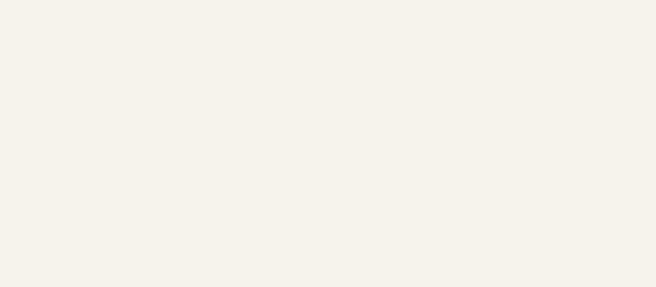
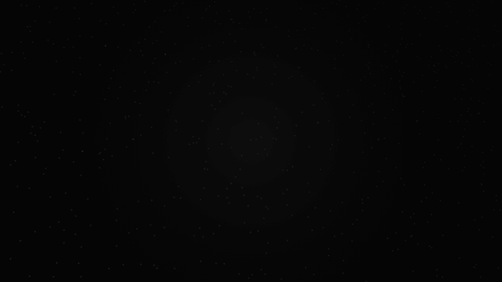

# fountain_pen

Text written out by a fountain pen, stroke by stroke, in Flutter.

<p align="center">
  
</p>

Not a font fading in, and not one letter at a time: each letter is drawn the way a hand draws it, stroke after stroke, in the
order a writer would. The nib lays down heavy downstrokes and hairline upstrokes. The ink glistens wet for a moment, and pools
a little where the pen lands. The hand slows into the turns and dots its i's once the word is done. No two letters come out
quite the same: each is a little turned, sized, lifted and spaced its own way, and the line wanders.

<p align="center">
  
</p>

## Use

```yaml
dependencies:
  fountain_pen:
    git: https://github.com/Rahiche/fountain_pen
```

```dart
import 'package:fountain_pen/fountain_pen.dart';

FountainPenText(
  'This text is rendered\nwith Flutter',
  fontSize: 64,
  ink: PenInk.blueBlack,
  duration: const Duration(seconds: 4), // or `speed:`, in em a second
  onComplete: () {},
)
```

It sizes itself to the writing and starts on its own. Use `autoplay: false`, `delay` and `repeat`, or give it a
`GlobalKey<FountainPenTextState>` and call `play()` or `reset()`.

### More control

`PenWriting` lays the text out and times it. Paint it as written by any moment, to put it anywhere: a slide, a texture, a
`CustomPainter` of your own.

```dart
final writing = PenWriting('Dear reader,', fontSize: 48, seed: 3);
// writing.duration: how long it takes (s); writing.size: the room it takes up.
writing.paint(canvas, centre, t); // t: seconds into the writing
```

The same `seed` writes the same way every time.

### Cameras

Film the writing instead of just showing it. `PenShotView` plays any of these:

- **`PenCloseUp(writing)`**: close on the pen at a hand's pace, gliding along the line. Then the pen hurries, like a
  time-lapse, as the camera eases out to the whole text.
- **`PenFilm(writing, angle: PenFilmAngle.sky)`**: a camera in 3D over the paper that follows the pen. It films from the
  `sky`, `low` along the line, or in an `orbit` round the pen, then pulls back to the whole line. Best with `PenInk.white`
  on its black paper.

```dart
PenShotView(PenFilm(PenWriting('Every letter goes on a journey', ink: PenInk.white), angle: PenFilmAngle.low))
```

## How it works

A hand (`PenHand`) holds every character's strokes as centre lines, in the order a hand draws them. They are traced from a
font's outlines: each glyph is thinned to its centre line and cut into a graph. The graph is walked the way a pen would go,
from the top left, carrying on through each fork along the smoothest way. Small detached parts, like an i's dot, wait until
the word is written.

`PenWriting` draws those lines with a nib, not with the font's own outlines:

- **Width:** the line is broad going down and fine coming up, broader again across the nib's edge.
- **Timing:** the pen's pace slows in the turns.
- **Ink:** it feathers into the paper, dries darker at its edges, and catches the light while it's wet.

## Make your own hand

The bundled hand, `homemadeApple`, is traced from [Homemade Apple](https://fonts.google.com/specimen/Homemade+Apple)
(Apache 2.0). Its capitals are quirky. To trace another script font you're licensed to use (macOS for the first step;
Python 3 with numpy for the rest):

```sh
mkdir -p tool/trace/work/raster
swift tool/trace/glyphs.swift path/to/Font.ttf tool/trace/work      # rasterise each glyph
python3 tool/trace/strokes.py tool/trace/work                       # trace its strokes → strokes.json
python3 tool/trace/to_dart.py tool/trace/work/strokes.json lib/src/hands/my_hand.dart \
    myHand "My Font" "Licensed under …"                             # → const myHand = PenHand(...)
```

Then `FountainPenText('…', hand: myHand)`. Or skip the Dart step and load the JSON with `PenHand.fromJson`. To see a trace,
run `cd tool/trace/work && python3 ../debug.py "abc" debug.ppm`: it draws each glyph's strokes in order over its raster.

## Limits

- **Latin only, for now:** Basic Latin, which is what's traced. Characters a hand has no strokes for are left as spaces.
- **No joins between letters:** letters connect only where the font's own strokes meet. Strokes aren't joined across
  letters.

## License

Apache 2.0. See [LICENSE](LICENSE) and [NOTICE](NOTICE); the bundled hand is derived from Homemade Apple, © 2010 Font Diner,
Inc., Apache 2.0.
