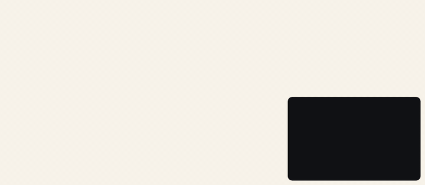
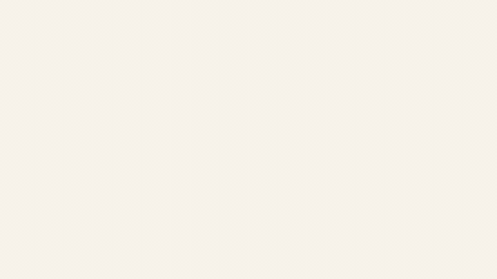
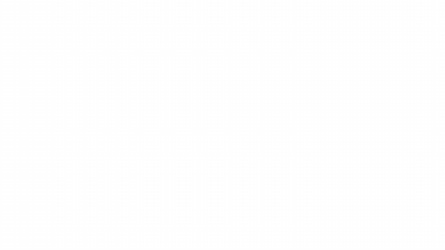
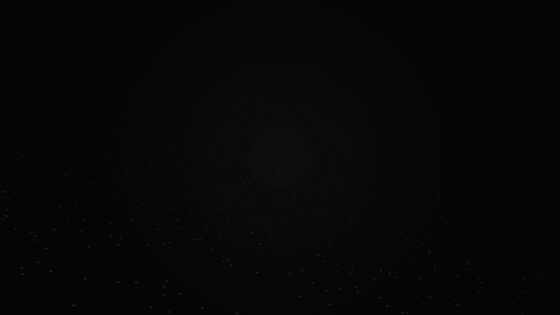
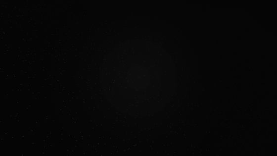
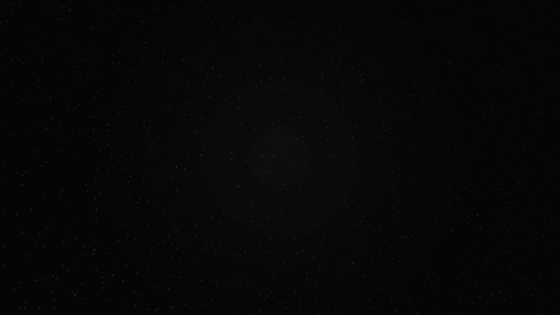
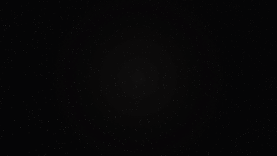

# Inks, hands and cameras

## Inks and nibs

`PenInk` is the pen and its ink:
- the colour;
- how broad the nib's downstrokes are against its hairlines;
- how much the hand wavers.

`PenInk.blueBlack` is the default; `PenInk.white` is for black paper.

```dart
FountainPenText('sepia', ink: const PenInk(color: Color(0xFF5B3A1E)))
FountainPenText('broad nib', ink: const PenInk(heavy: 0.36, fine: 0.05))
FountainPenText('steady hand', ink: const PenInk(waver: 0))
```

<p align="center"></p>

## Hands

Each `seed` is a different hand writing the same words, and the same seed writes the same way every time.

```dart
FountainPenText('Never quite the same twice', seed: 3)
```

<p align="center"></p>

## Cameras

Film the writing instead of just showing it. `PenShotView` plays any of these:

- **`PenCloseUp(writing)`:** close on the pen at a hand's pace, gliding along the line. Then the pen hurries, like a
  time-lapse, as the camera eases out to the whole text.
- **`PenFilm(writing, angle: …)`:** a camera in 3D over the paper that follows the pen. It films from the `sky`, `low`
  along the line, or in an `orbit` round the pen, then pulls back to the whole line. It looks best with `PenInk.white`
  on its black paper.

```dart
PenShotView(PenFilm(PenWriting('Every letter goes on a journey', ink: PenInk.white), angle: PenFilmAngle.low))
```

<table>
  <tr>
    <td><br>PenCloseUp</td>
    <td><br>PenFilm, sky</td>
  </tr>
  <tr>
    <td><br>PenFilm, low</td>
    <td><br>PenFilm, orbit</td>
  </tr>
  <tr>
    <td><br>Japanese, sky</td>
    <td><br>Arabic, sky</td>
  </tr>
</table>

`PenShotView` takes `autoplay`, `repeat` and `onComplete`, like `FountainPenText`.

To make these GIFs again, run `sh tool/demo/make_gifs.sh`.
