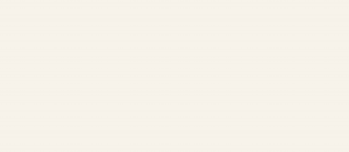
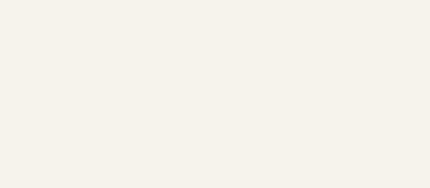

# Japanese and Arabic

## Japanese

`notoSansJapanese` writes Japanese. It covers:
- hiragana and katakana;
- the 6,355 kanji of JIS X 0208;
- Japanese punctuation and full-width forms;
- ASCII, for the Latin in between.

```dart
FountainPenText('このテキストは\nFlutterで描画されています', hand: notoSansJapanese)
```

<p align="center"></p>

It's written the way a Japanese hand writes:
- each stroke on its own, the pen lifted and carried to the next;
- a finer nib;
- horizontals rising a little to the right.

Each character's strokes come in its stroke order (筆順). Kana follow the order they're taught in. Kanji follow the
rules a hand is taught:
- top before bottom, and left before right;
- a crossbar before the vertical through it;
- a box's sides before what's in it, and its bottom after;
- 辶 last.

Those rules cover the common kanji. Some rarer ones have exceptions the rules don't know, so they may come out of
order.

The hand is about 1 MB of data, unpacked a character at a time as it's first written. An app that never uses it leaves
it out.

## Arabic, Persian and Urdu

`notoNaskhArabic` writes Arabic, and the extra letters of Persian and Urdu, from right to left:
- each letter in the form its neighbours call for;
- joined on to the next without the pen lifting;
- each word's dots and hamzas put in once the word's written.

```dart
FountainPenText('هذا النص\nمرسوم بفلاتر', hand: notoNaskhArabic)
FountainPenText('یہ تحریر قلم سے\nلکھی گئی ہے', hand: notoNaskhArabic) // Urdu
```

<p align="center">
  
  
</p>

A line runs right to left when its first letter is Arabic. Vowel marks are left out, and Latin within an Arabic line
isn't reordered.
